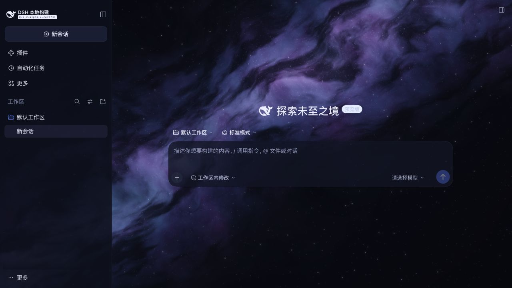

# 星河 · Galaxy

DeepSeek Harness 的独立皮肤插件。用原生 WebGPU / WGSL 实时渲染紫蓝星云、斜贯视野的银河尘带、远近星点与轻微闪烁，配合深空色调、淡紫强调色及半透明侧栏和输入框。无运行时 CDN、图片下载、视频、遥测或额外运行时依赖。



## 安装

从 npm 安装（推荐，版本固定、可校验完整性）：

```sh
dsh plugin --profile web add dsh-skin-galaxy
```

也可以直接跟踪 GitHub 仓库的最新提交：

```sh
dsh plugin --profile web add github:haoranx98/dsh-skin-galaxy
```

安装后先在「设置 → 插件」中停用其他普通皮肤，只保留皮肤市场和本皮肤，然后重启 `dsh web` 并刷新页面：

```sh
dsh web
```

不要让两个普通皮肤同时接管外观。宿主管理器可能把自己的已加载状态保存回去，覆盖手工编辑的启停清单，因此请在插件页用启用开关停用旧皮肤，不要直接改文件。

本地开发时也可以直接安装目录或生成的 `dsh-skin-galaxy-<version>.tgz`：

```sh
dsh plugin --profile web add /绝对路径/dsh-skin-galaxy
```

## 0.1.3 随机流星

在原生 WebGPU 着色器中绘制偶发流星：方向从完整 360° 随机选择，位置、速度和轨迹长度变化，亮点后方的拖尾逐渐收细、衰减。默认在每次结束后等待约 7～16 秒再出现下一颗，持续约 0.85～1.35 秒，不会排队积累。时间按页面实际可见的动画时长计数，独立于星云 speed 倍率；speed 为 0 或系统开启减少动态效果时不播放流星。

## 0.1.2 星云流动

星云不再只做整体平移：宽阔云团缓缓卷动，细丝与尘带以不同速度流动，银河轮廓起伏，远近星点产生轻微视差。沿用 30 FPS、减少动态效果和隐藏页面暂停规则；文字与阅读底板保持静止。新安装默认 speed 为 0.65，现有 profile 的显式 speed 配置仍优先。

## 0.1.1 阅读修复

正文改为明亮的近白色，辅助文字提亮，Markdown 正文和表格增加独立的半透明蓝灰阅读底板，输入框和侧栏提高不透明度。星河背景继续使用 WebGPU。对比度检查覆盖正文、辅助文字、侧栏和输入框，并按背景为纯白的最亮情况验证至少 4.5:1。该检查以旧皮肤已停用、星河配色有效为前提。

若出现「星河背景 + 黑字 + 白色侧栏」，请检查是否同时启用了其他皮肤。已确认旧皮肤的 `!important` 声明会覆盖主题服务提供的颜色，调整星河亮度不能解决这个冲突。

## 外观与生命周期

插件使用 dsh 的 `theme.overrideTokens` 接口提供皮肤层，同时适配宿主的 light / dark / system 配置，不改写你的外观偏好。宿主异步读取设置时，星河皮肤不会消失。停用本插件会撤回配色、画布、样式、观察器、事件监听和 GPU 资源，并恢复宿主原来的主题。需要恢复默认外观时，在插件管理器停用 `dsh-skin-galaxy`。

默认 30 FPS，像素比上限 1.25，画布最大 1920 × 1200；较大的显示器按比例缩放。页面隐藏时停止绘制，回到页面后恢复；系统开启“减少动态效果”或 speed 为 0 时，只绘制静态 GPU 帧。适配器不可用、WGSL 编译失败或 GPU 设备丢失时，保留静态渐变星云底色，并在开发者控制台说明原因。

## 调整

在 profile 的 `cordis.patch.yml` 中添加下列覆盖（config 替换整行配置）：

```yaml
- id: galaxy-skin
  config:
    speed: 0.65
    intensity: 0.8
    pixelRatio: 1.25
    fps: 30
    meteorInterval: 10
```

| 配置 | 范围 | 含义 |
| --- | --- | --- |
| speed | 0–2 | 星云漂移与闪烁速度；0 为静态 |
| intensity | 0–2 | 星云及银河星尘亮度 |
| pixelRatio | 0.5–2 | 渲染像素比上限 |
| fps | 1–60 | 绘制帧率上限 |
| meteorInterval | 3–60 | 流星基础等待秒数，实际间隔在此值的 0.7～1.6 倍之间随机 |

调整后重启服务并刷新。值非法时插件会明确报错。

## 本地开发与预览

使用本机源码仓库已经安装的 TypeScript 和 tsdown，不额外安装依赖：

```sh
node build.mjs
node --test tests/*.test.mjs
node preview/server.mjs
```

打开 <http://127.0.0.1:4318> 查看独立效果演示。演示使用相同的插件产物和 GPU 着色器，周围界面是展示用模型；真实 dsh 效果见 `screenshots/dsh-galaxy.png`。

其他机器构建时用 `DSH_SOURCE=/你的/deepseek-harness node build.mjs` 指定已完成构建的 dsh 源码。发布产物 `lib/` 已随仓库提交，可以直接加载，无需构建工具。

## 验证与兼容性

- 开发与验证环境：dsh 源码 `0.2.2-alpha.2`，Node `24.22.1`，macOS。
- 构建与严格 TypeScript 检查通过；自动测试 11/11 通过。
- 自动测试覆盖配置、实际绘制调用、分辨率上限、帧率、页面隐藏、减少动态效果、不支持 WebGPU、着色器错误、异步设备分配期间停用，以及产物加载/撤回。
- 真实 dsh 页面已确认 `data-galaxy-renderer="webgpu"`，且浏览器未报告脚本或 WebGPU 错误。
- 本插件需要浏览器实际提供 WebGPU；优先使用本机 localhost 或 HTTPS。[WebGPU 运行条件](https://developer.mozilla.org/en-US/docs/Web/API/WebGPU_API)。其他浏览器或不同 dsh 版本仍需验证。
- 版本兼容范围尚未逐一验证；`package.json` 未声明 `engines.dsh`，以便在不同 dsh 版本上测试。

## 许可

MIT，见 [LICENSE](LICENSE)。

预览未连接模型，也不会自动发起模型请求。插件不会修改聊天记录或发送内容。
